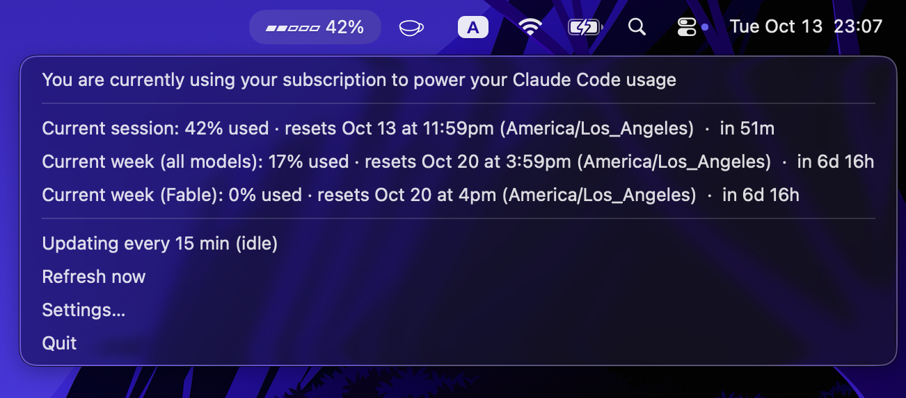
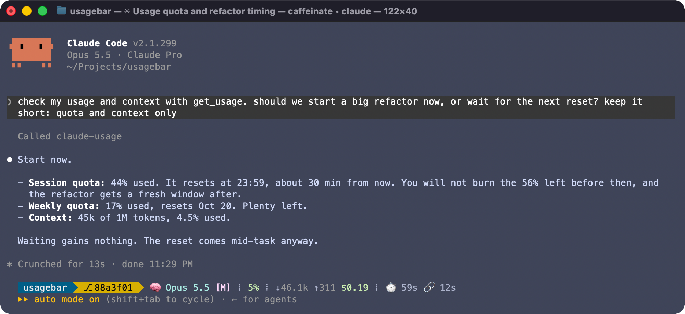

# usagebar

Your Claude Code plan quota in the macOS menu bar, plus an MCP tool so agents can
check the quota and their own context size before starting big work.



Not affiliated with Anthropic. It reads what `claude -p /usage` prints and the
transcripts Claude Code keeps in `~/.claude/projects/`. Neither format is documented,
so a Claude Code release can break parsing until usagebar is updated.

## Install

    curl -fsSL https://usagebar.dnlbit.com/install.sh | sh

Installs into `~/.local/share/usagebar` (Python venv with `rumps`), starts at login,
and prints the `claude mcp add` command for the MCP tool. Needs macOS, `python3` 3.9+
and `claude` on your PATH.

Updates: the app checks GitHub Releases once a day and shows "Update to vX.Y.Z" in
its menu. Click it to install and restart. Nothing updates without that click.
Rerunning the install command also updates.

Uninstall:

    launchctl bootout gui/$(id -u)/com.dnlbit.usagebar
    rm -rf ~/.local/share/usagebar ~/Library/LaunchAgents/com.dnlbit.usagebar.plist \
      ~/.config/usagebar.json ~/.cache/usagebar
    claude mcp remove usagebar -s user

## Menu bar

The bar shows the current session quota (`▰▰▱▱▱ 48%`). Hover for the reset time, click
for each quota with "in 1h 52m" after its reset time.

Settings… holds:

- Idle interval (default 20 min): poll rate while usage is flat.
- Active interval (default 5 min): used after a poll sees the percentages change,
  until a poll sees no change.
- Auto start at login: writes `~/Library/LaunchAgents/com.dnlbit.usagebar.plist`
  (unchecking removes it). Takes effect at next login. Homebrew installs have no
  checkbox: use `brew services start usagebar` to start at login.

Intervals are saved to `~/.config/usagebar.json`. Log: `/tmp/usagebar.log`.

## MCP tool



`mcp_server.py` (standard library only) gives agents one tool, `get_usage`, returning:

- `plan`: quota percentages and reset times, shared with the menu bar app through
  `~/.cache/usagebar/last.json`. If that is older than `max_age_minutes` (default 2;
  0 forces it), the tool runs `claude -p /usage` itself (about 2s), so it works
  without the app. `fetched_at` says how fresh it is.
- `context`: tokens in the calling Claude Code session's context, the model's max
  window (hard-coded table in `mcp_server.py`) and percent used.

Either part comes back as `{"error": ...}` on its own if it fails. Example (`text`,
the raw `/usage` output, shortened):

```json
{
 "plan": {
  "fetched_at": "2026-10-13T22:53:05-07:00",
  "error": null,
  "quotas": {
   "Current session": {"percent_used": 41, "resets_at": "2026-10-13T23:59:00-07:00"},
   "Current week (all models)": {"percent_used": 16, "resets_at": "2026-10-20T15:59:00-07:00"},
   "Current week (Fable)": {"percent_used": 0, "resets_at": "2026-10-20T16:00:00-07:00"}
  },
  "text": "You are currently using your subscription to power your Claude Code usage\n\nCurrent session: 41% used …"
 },
 "context": {
  "session_id": "a659f724-dd01-40c3-bcbe-6a3d33bd43a6",
  "model": "claude-opus-5-5",
  "context_tokens": 135210,
  "window_tokens": 1000000,
  "percent_used": 13.5
 }
}
```

Agents can use it to decide when to stop, split work into subagents, or wait for a
reset, for example: "check get_usage every hour; if the session is above 80%, finish
the current step and stop".

## Privacy

Everything stays on your machine. The only network requests are the ones `claude`
makes itself and the daily update check to `api.github.com`.

## Development

    python3 -m venv .venv && .venv/bin/pip install -r requirements.txt
    ./run.sh
    python3 monitor.py --test && python3 mcp_server.py --test

A git checkout never offers updates. Release: bump `__version__` in `monitor.py`,
commit, then `gh release create vX.Y.Z --generate-notes`.
